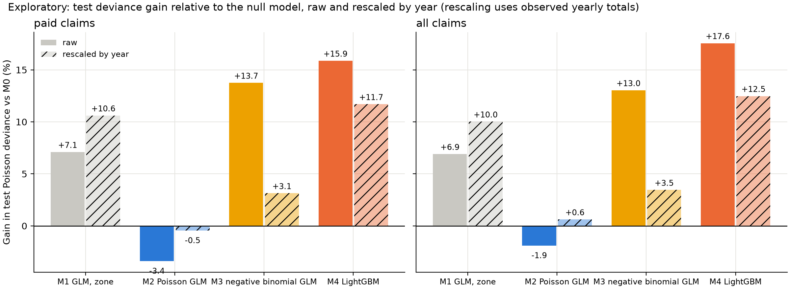
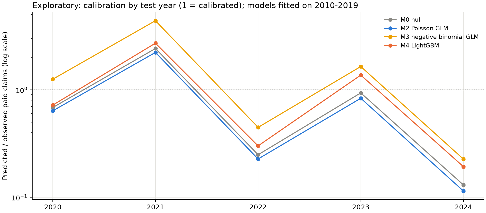
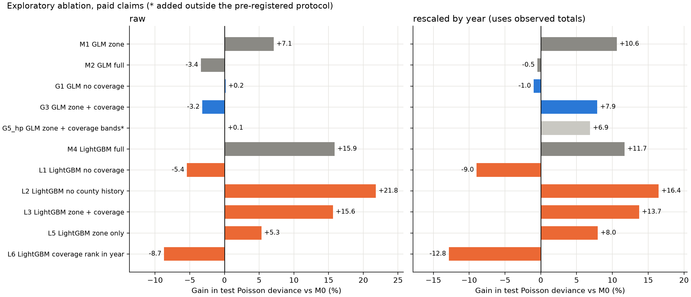
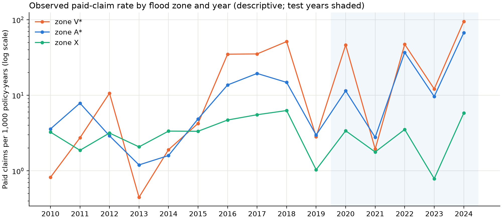

<!--
Analyse préliminaire (exploratoire) : modélisation de la fréquence
15/11/2026 · branche modeles-premier-jet · version v0.1
Résultats provisoires et exploratoires, voir Analyse_preliminaire/STATUT_RESULTATS.md · aucun commit à ce stade.
Section rédigée en anglais (CLAUDE.md : English only, no em dashes, every number from code output).
Aucun chiffre n'est écrit à la main : ck("clé") lit Analyse_preliminaire/tableaux/chiffres_cles.json
(voir TRACABILITE.md). Les commentaires <!- - Rk - -> renvoient au registre STATUT_RESULTATS.md.
-->

# Preliminary Analysis (Exploratory): Claim Frequency Modelling {#sec-ap}

```{python}
#| label: ap-setup
#| echo: false
#| output: false
# Loads the key numbers and tables of the preliminary analysis (no model is fitted here).
import json
from pathlib import Path

import pandas as pd
from IPython.display import Markdown, display

_start = Path.cwd().resolve()
AP_DIR = next(p / "Analyse_preliminaire" for p in [_start, *_start.parents]
              if (p / "Analyse_preliminaire" / "tableaux" / "chiffres_cles.json").exists())
_ck = json.loads((AP_DIR / "tableaux" / "chiffres_cles.json").read_text(encoding="utf-8"))


def ck(key):
    """Formatted value of a key number (source cell given in Analyse_preliminaire/TRACABILITE.md)."""
    return _ck[key]["affichage"]


def ap_table(name):
    return pd.read_csv(AP_DIR / "tableaux" / f"{name}.csv")
```

## Status of the results

Every result below carries one label. **[Established]**: a verified, reproducible computation that does not depend on the models compared on the test years (data pipeline, technical checks, descriptive facts). **[Provisional, exploratory]**: a correct computation whose scope is limited by the design (five test years, dependence between cells, variants compared on the same test years, four features, rescaling that uses observed totals). **[Not demonstrated]**: a hypothesis that was not tested. The register of results and the conditions under which each label may change are in `Analyse_preliminaire/STATUT_RESULTATS.md`. These results are a first exploratory pass, not the final models of the project.

## Summary

On a county by flood zone by year table of FEMA Region 4 (training 2010 to 2019, test 2020 to 2024), we fitted a null model, Poisson and negative binomial GLMs and a LightGBM model with a Poisson objective, all with exposure as an offset. At this stage, and with the four features available before each year, no model beats a GLM with the flood zone alone in a robust way once the yearly level is removed. The raw advantage of LightGBM depends on the nominal mean building coverage, the past-claim features do not help out of period, and the yearly level varies with events that no feature captures. We report this as an informative negative result. All model comparisons are provisional.

## Question and change of direction

The initial proposal of the project addressed claim severity and the pure premium at the policy level. The current work addresses claim frequency, because the redacted OpenFEMA claims and policies share no identifier: a claim cannot be linked to the policy that covered it, so no policy-level table with exposure can be built, and claims and exposure can only be joined in aggregate (see the Data section of this report). The question of this section is therefore the one of the update: does LightGBM with a Poisson objective predict claim frequency better than a Poisson GLM or a negative binomial GLM?

## Data and cleaning [Established]

<!-- R1 --><!-- R2 -->
The data are the OpenFEMA NFIP v3 claims and policies for FEMA Region 4, single-family homes only. Of the `{python} ck("raw_claims")` raw claims, `{python} ck("single_family")` are single-family homes; `{python} ck("anomalies")` of them were set aside as anomalies, each with its reason (@tbl-ap-anomalies; `{python} ck("anom_two_reasons")` claims have two reasons), which leaves `{python} ck("clean_claims")` cleaned claims.

```{python}
#| label: tbl-ap-volumes
#| tbl-cap: "Data volumes [Established]. Sources: Data_cleaning/clean/cleaning_report.md, EDA/ds_clean_roles.json, Modeles/resultats/preparation.json and ajustement_payes.json."
#| echo: false
display(ap_table("tab_ap_volumes"))
```

```{python}
#| label: tbl-ap-anomalies
#| tbl-cap: "Claims set aside as anomalies [Established]. Source: Data_cleaning/clean/cleaning_report.md."
#| echo: false
display(ap_table("tab_ap_anomalies"))
```

## Analysis table [Established]

<!-- R3 --><!-- R4 --><!-- R5 -->
The unit is the county by flood zone (V, A, X) by calendar year, not the census tract planned for the final models. The table `ds_clean` has `{python} ck("ds_rows")` rows over `{python} ck("ds_counties")` counties and `{python} ck("policy_years")` policy-years. The target counts claims with a positive building paid amount, with all claims as a second target; the offset is the logarithm of the exposure in policy-years. The features are the flood zone, the mean building coverage in nominal dollars, and the paid claims of 1990 to 2008 per 1,000 average policies, for the cell and for the county. The year, premiums, the county identifier and all post-loss variables (water depth, event) are excluded. `{python} ck("rows_excluded")` test rows with a missing feature are excluded; they hold no claim and change the test deviance of the reference models by at most `{python} ck("excl13_dev_effect")` in relative terms. This leaves `{python} ck("rows_train")` training rows and `{python} ck("rows_test")` test rows, with `{python} ck("claims_train_paid")` and `{python} ck("claims_test_paid")` paid claims (`{python} ck("claims_train_all")` and `{python} ck("claims_test_all")` claims in total). The observed frequency is `{python} ck("freq_train")` paid claims per 1,000 policy-years in training and `{python} ck("freq_test")` in test, and 2024 alone holds `{python} ck("share_2024_test")` of the paid claims of the test years.

## Protocol

The hypotheses and the evaluation plan were written and time-stamped before any model was fitted (`Modeles/PROTOCOLE.md`, 15/11/2026 at 17:34; `Modeles/complements/PROTOCOLE_COMPLEMENTAIRE.md`, at 17:52), and they were not changed afterwards. One amendment, written before any fit, changed the LightGBM offset (below). The models are a null model (training rate times exposure), a Poisson GLM with the zone only, a Poisson GLM and a negative binomial GLM with the four features, and LightGBM with the same features, tuned on 2010 to 2017 with validation on 2018 to 2019. The main metric is the Poisson deviance on the test years, reported as a gain relative to the null model, with and without 2024, with calibration (predicted over observed claims) by year. A diagnostic multiplies each model, year by year, by the ratio of observed to predicted claims: it removes the error on the yearly level and keeps only the allocation between cells, but it uses the observed totals of the test years and is not a prediction.

<!-- R6 --><!-- R7 -->
**Technical checks [Established].** The checks V1 to V8 of the first pass passed, and the complementary checks VC1, VC2 and VC4 are conform; VC3 flags a possible change in zone coding, discussed below (@tbl-ap-verifications). With an initial score equal to the log exposure alone, LightGBM disables its start from the average and under-estimates the intercept; the amended procedure adds the log of the training rate and reproduces the training total (ratio `{python} ck("m4_nonreg")`). The early-stopping metric of the validation matches a recomputation by hand (maximum difference `{python} ck("vc1_metric_diff")`), and the negative binomial fit is reproduced by an independent GLM (maximum coefficient difference `{python} ck("vc2_coef_diff")`).

## Exploratory results

### Deviance gains relative to the null model [Provisional, exploratory]

<!-- R10 --><!-- R11 -->
Raw test gains are `{python} ck("gain_test_M4_payes")` for LightGBM (M4), `{python} ck("gain_test_M3_payes")` for the negative binomial GLM (M3), `{python} ck("gain_test_M1_payes")` for the GLM with the zone only (M1) and `{python} ck("gain_test_M2_payes")` for the Poisson GLM with four features (M2), for paid claims (@tbl-ap-gains, @fig-ap-gains). Once the yearly level is removed, the gains become `{python} ck("gain_recal_M4_payes")` (M4), `{python} ck("gain_recal_M1_payes")` (M1), `{python} ck("gain_recal_M3_payes")` (M3) and `{python} ck("gain_recal_M2_payes")` (M2): the zone alone carries `{python} ck("zone_share_m4")` of the rescaled gain of M4. The non-predictive reference with a year effect fitted on the test years (M_oracle) reaches `{python} ck("gain_test_M_oracle_payes")`, which shows how much of the deviance is the yearly level.

{#fig-ap-gains}

```{python}
#| label: tbl-ap-gains
#| tbl-cap: "Gain in test Poisson deviance relative to the null model, in % [Provisional, exploratory]. Sources: Modeles/resultats/deviance_par_modele.csv and diagnostic_deviance_recalee_par_annee.csv."
#| echo: false
display(ap_table("tab_ap_gains"))
```

<!-- R9 --><!-- R8 -->
The negative binomial GLM predicts `{python} ck("m3_train_ratio")` times the observed total on the training years, and `{python} ck("nb_const_ratio")` times with the intercept and offset only: its maximum likelihood estimate does not equate predicted and observed totals [Established]. Its raw test gain therefore mixes ranking and level. The Pearson dispersion of M2 is `{python} ck("m2_pearson_disp")` and its robust standard errors are about `{python} ck("se_ratio_vzone")` times the model-based ones, so no coefficient is interpreted as an inference [Established].

### Calibration by year [Provisional, exploratory]

<!-- R12 -->
Over the test years, the models predict between `{python} ck("ratio_test_M2")` (M2) and `{python} ck("ratio_test_M3")` (M3) of the observed paid claims (@tbl-ap-calibration, @fig-ap-calibration). The error is not uniform: LightGBM predicts `{python} ck("ratio_2021_M4")` times the observed claims in 2021, but only `{python} ck("ratio_2022_M4")` and `{python} ck("ratio_2024_M4")` times in 2022 and 2024, the years of Hurricanes Ian and Helene.

{#fig-ap-calibration}

```{python}
#| label: tbl-ap-calibration
#| tbl-cap: "Predicted / observed paid claims by test year [Provisional, exploratory]. Sources: Modeles/resultats/par_annee_calibration_deviance.csv and calibration_totale_par_periode.csv."
#| echo: false
display(ap_table("tab_ap_calibration"))
```

### Ablation [Provisional, exploratory]

<!-- R13 --><!-- R14 -->
Removing the nominal coverage from LightGBM turns its gain from `{python} ck("gain_test_M4_payes")` to `{python} ck("abl_L1_raw")` (rescaled: `{python} ck("abl_L1_rec")`), while LightGBM with the zone and coverage only keeps `{python} ck("abl_L3_raw")` (rescaled `{python} ck("abl_L3_rec")`). Replacing the coverage by its rank within the year gives `{python} ck("abl_L6_raw")`, and a GLM with coverage bands, added outside the protocol, gives `{python} ck("abl_G5_hp_raw")` (rescaled `{python} ck("abl_G5_hp_rec")`). Removing the county history improves LightGBM to `{python} ck("abl_L2_raw")` (rescaled `{python} ck("abl_L2_rec")`); this variant was selected by looking at the test years. In the GLMs, adding the two past-claim features to the zone lowers the rescaled gain from `{python} ck("gain_recal_M1_payes")` (M1) to `{python} ck("abl_G1_rec")` (G1). LightGBM with the zone only reaches `{python} ck("abl_L5_raw")` (rescaled `{python} ck("abl_L5_rec")`), below M1. It is also below M1 on the training years (`{python} ck("abl_L5_train")` against `{python} ck("abl_M1_train")`), where M1 is the maximum likelihood zone-only model: with the number of iterations of the full model, which was not re-optimised for each variant, it remains under-fitted.

{#fig-ap-ablation}

```{python}
#| label: tbl-ap-ablation
#| tbl-cap: "Ablation, paid claims: gain relative to the null model (%) and predicted / observed over the test years [Provisional, exploratory]. Sources: Modeles/complements/resultats/ablation_deviance.csv and ablation_calibration_annee.csv. G5_hp was added outside the protocol."
#| echo: false
display(ap_table("tab_ap_ablation_paid"))
```

### Shift of observed rates by zone [Established, descriptive]

<!-- R16 --><!-- R17 -->
Between training and test, the observed paid-claim rate is multiplied by `{python} ck("mult_A")` in A zones, `{python} ck("mult_V")` in V zones and `{python} ck("mult_X")` in X zones (@tbl-ap-zone-shift, @fig-ap-zone-rates). The X zones hold between `{python} ck("x_expo_share_min")` and `{python} ck("x_expo_share_max")` of the exposure from 2018 to 2024, but their share of paid claims falls from `{python} ck("x_claims_share_2021")` in 2021 to `{python} ck("x_claims_share_2022")` in 2022. The highest coverage band (training quintiles) holds `{python} ck("t5_expo_train")` of the training exposure and `{python} ck("t5_expo_test")` of the test exposure, and its observed rate rises from `{python} ck("t5_rate_train")` to `{python} ck("t5_rate_test")` per 1,000 policy-years.

<!-- R18 --><!-- R21 -->
Why the rates shift between zones is **[Not demonstrated]**: the geography of the test-year events and a change in the recording of flood zones with Risk Rating 2.0 are two hypotheses, and the zone codes on the policy side have not been checked.

{#fig-ap-zone-rates}

```{python}
#| label: tbl-ap-zone-shift
#| tbl-cap: "Observed claims per 1,000 policy-years by zone, training and test periods [Established, descriptive]. Source: Modeles/complements/resultats/vc3_multiplicateur_zone.csv."
#| echo: false
display(ap_table("tab_ap_zone_shift"))
```

### Features [Provisional, exploratory]

<!-- R15 -->
Permuting the zone or the coverage in the test years increases the test deviance of LightGBM by `{python} ck("perm_zone")` and `{python} ck("perm_cov")`, while permuting the county history decreases it by `{python} ck("perm_chist")`, although this feature carries `{python} ck("gain_share_chist")` of the training gain (@tbl-ap-importance). Coefficients and standard errors are in @tbl-ap-coefficients; given the overdispersion, they are descriptive only.

```{python}
#| label: tbl-ap-importance
#| tbl-cap: "LightGBM (M4) feature importance, paid claims [Provisional, exploratory]. Sources: Modeles/resultats/importance_permutation_test_m4.csv and importance_gain_payes.csv."
#| echo: false
display(ap_table("tab_ap_importance"))
```

## Reading at this stage

In this design, with the features known before each year, no model beats the zone-only GLM in a robust way out of period once the yearly level is removed; the past-claim features bring nothing out of period; the raw advantage of LightGBM depends on the nominal coverage, which may act as a proxy for time **[Not demonstrated]** <!-- R19 -->; the yearly level depends on events that no feature captures; and the shift of rates between zones is an observation whose cause is not established. We read this as an informative negative result for the update: it identifies what the next models must address, rather than which model is better.

## What is not concluded

- No ranking of the models and no preferred model: the gains are provisional, measured on five test years, and the ablation variants were compared on the same test years.
- No cause for the shift of rates between A and X zones, and no mechanism for the role of the nominal coverage.
- No role of the dispersion parameter in the level of the negative binomial predictions <!-- R20 --> **[Not demonstrated]**.
- No validation of the exposure of the smallest cells <!-- R22 --> **[Not demonstrated]**.

## Limitations

<!-- R23 -->
- Five test years only, with 2024 holding `{python} ck("share_2024_test")` of the paid claims of the test years; the yearly bootstrap of the first pass yields only `{python} ck("boot_distinct")` distinct resamples, so no reliable uncertainty is available.
- Dependence between cells hit by the same event, and strong overdispersion.
- The rescaled diagnostic uses observed totals of the test years.
- Nominal coverage; four features only; county by zone unit instead of census tract.
- Exposure built from policy transactions without a claim key.
- The paid-claim target depends on the claim settlement policy.

## Next steps (to do, not done)

1. Check the coding of the flood zone on the policy side before and after 2021.
2. Observed frequency by decile of exposure, to validate small cells.
3. Rescaling by year and zone, and a ranking metric (Gini index with offset).
4. Rolling-origin evaluation over more years, for example predicting each year of 2016 to 2024 from earlier years.
5. Re-optimised number of LightGBM iterations for each variant.
6. The census tract by year table planned by the project.

## Reproducibility

The results are produced by `bash Modeles/run_all.sh` and `bash Modeles/complements/run_all.sh` (Python 3.13.0, statsmodels 0.15.0, LightGBM 4.7.0, seed 42). The SHA-256 checksums of the inputs are in `Modeles/ENTREES.txt` and `Modeles/complements/ENTREES.txt`. Without Homebrew, LightGBM uses the `libomp` library shipped with scikit-learn in the local environment (documented in `Modeles/VERIFICATIONS.md`). The numbers of this section are read from `Analyse_preliminaire/tableaux/chiffres_cles.json`, built by `Analyse_preliminaire/scripts/extraire.py` and checked by `Analyse_preliminaire/scripts/verifier_chiffres.py`.

## Appendix: complete tables of the preliminary analysis {#sec-ap-appendix}

```{python}
#| label: tbl-ap-coefficients
#| tbl-cap: "M2 and M3 coefficients, paid claims; standard errors indicative only [Provisional, exploratory]. Source: Modeles/resultats/coefficients_payes.csv."
#| echo: false
display(ap_table("tab_ap_coefficients"))
```

```{python}
#| label: tbl-ap-ablation-all
#| tbl-cap: "Ablation, all claims [Provisional, exploratory]. Sources: Modeles/complements/resultats/ablation_deviance.csv and ablation_calibration_annee.csv."
#| echo: false
display(ap_table("tab_ap_ablation_all"))
```

```{python}
#| label: tbl-ap-annexe-complete
#| tbl-cap: "Full ablation, gain relative to the null model (%) for every evaluation set [Provisional, exploratory]. Source: Modeles/complements/resultats/ablation_deviance.csv."
#| echo: false
display(ap_table("tab_ap_annexe_ablation_complete"))
```

```{python}
#| label: tbl-ap-annexe-calibration
#| tbl-cap: "Predicted / observed paid claims by test year, all ablation models [Provisional, exploratory]. Source: Modeles/complements/resultats/ablation_calibration_annee.csv."
#| echo: false
display(ap_table("tab_ap_annexe_calibration"))
```

```{python}
#| label: tbl-ap-annexe-diff
#| tbl-cap: "Deviance difference with the reference model by test year; negative means lower deviance than the reference [Provisional, exploratory]. Source: Modeles/complements/resultats/ablation_diff_par_annee.csv."
#| echo: false
display(ap_table("tab_ap_annexe_diff_annee"))
```

```{python}
#| label: tbl-ap-annexe-glm
#| tbl-cap: "Coefficients of the ablation GLMs, paid claims; indicative standard errors [Provisional, exploratory]. Source: Modeles/complements/resultats/ablation_coefficients_glm.csv."
#| echo: false
display(ap_table("tab_ap_annexe_coefficients_glm"))
```

```{python}
#| label: tbl-ap-verifications
#| tbl-cap: "Technical checks V1 to V8 and VC1 to VC4, with status as recorded in the source files (in French) [Established]. Sources: Modeles/VERIFICATIONS.md and Modeles/complements/VERIFICATIONS_COMPLEMENTAIRES.md."
#| echo: false
display(ap_table("tab_ap_annexe_verifications"))
```
