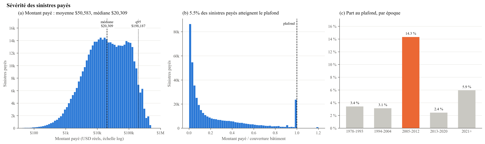
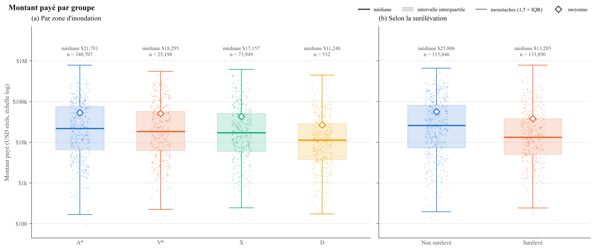
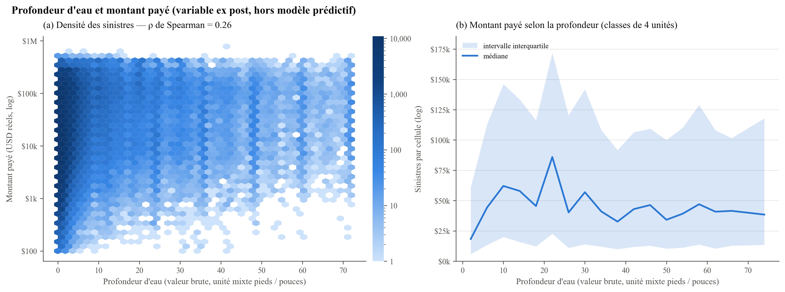

```{python}
#| label: setup
#| echo: false
#| message: false
#| output: false
# Setup code chunk to load the packages, the project root and the source directory

import importlib.util
import os
import sys
import types
from pathlib import Path


def resolve_report_dir() -> Path:
    if "__file__" in globals():
        return Path(__file__).resolve().parent
    doc_path = os.environ.get("QUARTO_DOCUMENT_PATH")
    if doc_path:
        return Path(doc_path).resolve()
    return Path.cwd().resolve()


def resolve_project_root(start: Path) -> Path:
    env_root = os.environ.get("QUARTO_PROJECT_ROOT")
    if env_root:
        root = Path(env_root).resolve()
        if (root / "src").is_dir():
            return root

    search_start = start

    doc_path = os.environ.get("QUARTO_DOCUMENT_PATH")
    if doc_path:
        candidate = Path(doc_path).resolve()
        if candidate.is_file():
            candidate = candidate.parent
        search_start = candidate

    for candidate in [search_start, *search_start.parents]:
        print(f"Checking candidate for project root: {candidate}")
        if (candidate / "src").is_dir():
            print(f"Resolved project root: {candidate}")
            return candidate

    raise FileNotFoundError(
        "Could not locate a project root containing a 'src' directory. "
        "Update the Quarto setup chunk to point to your project root."
    )


report_dir = resolve_report_dir()
project_root = resolve_project_root(report_dir)
src_dir = project_root / "src"

print(f"Report directory resolved to: {report_dir}")
print(f"Project root resolved to: {project_root}")
print(f"Source directory resolved to: {src_dir}")

if str(src_dir) not in sys.path:
    sys.path.insert(0, str(src_dir))

runtime_module = types.ModuleType("quarto_runtime")
runtime_module.project_root = project_root
runtime_module.report_dir = report_dir
sys.modules["quarto_runtime"] = runtime_module

module_path = src_dir / "project_setup.py"
spec = importlib.util.spec_from_file_location("project_setup", module_path)
if spec is None or spec.loader is None:
    raise ImportError(f"Unable to load project_setup from {module_path}")

project_setup = importlib.util.module_from_spec(spec)
sys.modules["project_setup"] = project_setup
spec.loader.exec_module(project_setup)

project_setup.configure_environment(project_root=project_root)
```







# Use of AI Tools {.unnumbered}

Generative AI was used in this project. Claude (Anthropic), through the Claude Code assistant, was used to draft the structure and text of this report from facts and decisions provided by the team, to write the code cells that compute the statistics shown in the report, and to check the repository for consistency. All numbers in the report are produced by code from the project data. The team reviewed the content and is responsible for it.

**[TO FILL BY TEAM: any other use of AI tools during the project (for example for the cleaning and EDA scripts), and confirmation that this statement follows the course policy]**

# References {.unnumbered}

::: {#refs}
:::

# Appendices {.unnumbered}

### Appendix A: Additional Exploratory Plots {#sec-appendix-plots}

These figures come from the claim-level exploratory analysis (`EDA/EDA.py`) and describe paid amounts rather than claim frequency. They are kept here because they document the data, but they do not enter the frequency models.

{#fig-eda-severity}

{#fig-eda-boxes}

{#fig-eda-depth}

{#fig-eda-modelvars}

The median paid amount is `{python} f"{eda_metrics['sev_median']:,.0f}"` USD and the mean `{python} f"{eda_metrics['sev_mean']:,.0f}"` USD (real dollars), and `{python} f"{eda_metrics['at_cap']:.1%}"` of paid claims reach the coverage limit (@fig-eda-severity). Amounts are strongly right-skewed and much larger in the major hurricanes (@fig-eda-modelvars). These patterns concern severity and are outside the scope of the frequency comparison.

### Appendix B: Complete Code Listings {#sec-appendix-code}

The code is in the project repository, <https://github.com/lucaslhmnn/Data_science_UNIL_Project>:

- `Data_cleaning/clean/clean_data.py`: audit of the raw files, treatment of sentinel values, cleaning of the claims and computation of the policy exposure (`zone_year.parquet`);
- `EDA/dsEDA.py` and `EDA/EDA.py`: claim-level dataset for the exploratory analysis, and the figures shown in @sec-eda and @sec-appendix-plots;
- `quarto_report/`: this report, whose code cells compute all statistics from the cleaned files.

### Appendix C: Supplementary Tables {#sec-appendix-tables}

```{python}
#| label: tbl-anomalies
#| tbl-cap: "Claims set aside as anomalies during cleaning, by reason (a claim can have several reasons)."

reason_en = {
    "âge négatif": "negative building age",
    "doublon exact": "exact duplicate",
    "paiement sans couverture": "payment without coverage",
    "paiement négatif": "negative payment",
}
anomaly_table = (
    anomalies["motif"]
    .map(lambda m: "; ".join(reason_en.get(part.strip(), part.strip()) for part in m.split(";")))
    .value_counts()
    .rename_axis("reason")
    .reset_index(name="claims")
)
display(anomaly_table)
```
